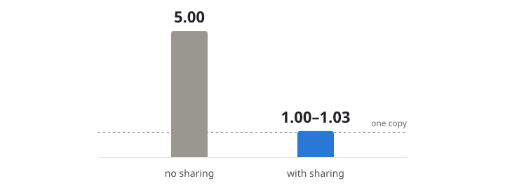
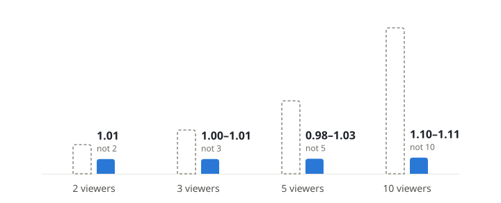
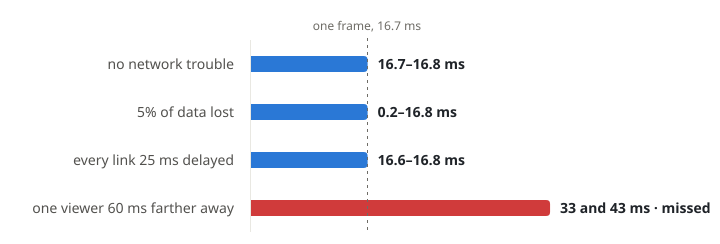

<h1 align="center">Murmur</h1>

<p align="center">
  
  
  
  
</p>

<p align="center"><strong>Watch a video file together, in sync, shared browser to browser instead of uploaded to a server.</strong></p>

<p align="center"><a href="https://murmurwatch.duckdns.org">Try it in your browser</a></p>

<p align="center">
  
</p>

## What it does

Murmur is a watchalong app that keeps everyone in tight sync and shares the video peer to peer:
every screen stays within one frame (16.7 ms) of the others, and with 5 viewers the host uploads
about one copy of the video instead of five.

The video file stays on the host's computer and is never uploaded to a server. The host's browser
streams it to the viewers, and the viewers pass pieces on to each other. One person picks a file and
sends an invite link, and everyone who opens it watches together.

## Results

**With 5 viewers, the host uploads about one copy of the video instead of five.**

<p align="center">
<picture>
  <source media="(prefers-color-scheme: dark)" srcset="images/sharing-dark.svg">
  
</picture>
</p>

**Bigger rooms barely cost the host more: 10 viewers take 1.10–1.11 copies, not 10.**

<p align="center">
<picture>
  <source media="(prefers-color-scheme: dark)" srcset="images/room-size-dark.svg">
  
</picture>
</p>

**Screens stay within one frame of each other.**

<p align="center">
<picture>
  <source media="(prefers-color-scheme: dark)" srcset="images/sync-dark.svg">
  
</picture>
</p>

**The host's upload runs about 30% full, where the sharing library's defaults keep it about 99% full.**

**An hour-long room played through with no freezes.**

## How it works

```
host's file ──► host's browser tab ──► viewer ◄──► viewer ◄──► viewer
                (cuts it into pieces)       (pass pieces on to each other)

room server: keeps clocks and play/pause in step; never sees the video
```

- **Shared clock.** Each browser works out how far its clock is from the room server's.
- **Speed control.** Each viewer nudges its playback speed by at most 1% to stay on the room's position.
- **Paced sharing.** Browsers fetch ahead only as fast as the host's upload allows, so the room stays ahead.
- **One first fetcher per piece.** When everyone needs the same piece at once, one viewer fetches it and the rest take it from them.
- **The host's tab is the source.** The host's browser converts the file into pieces itself, with no re-encode and no server.

Built on `hls.js`, `p2p-media-loader`, WebRTC, `mp4box.js` and React.

## Run it locally

Needs Node 24 and Chrome or another Chromium browser.

```bash
cd app
npm install
npm run dev:file   # serves http://127.0.0.1:8100 with a local tracker
```

Open `http://127.0.0.1:8100`, choose **Host a room**, pick a video file, and open the invite link
in a second window to join as a viewer.

## Run the tests

```bash
cd app
npm install
npm run check   # structural rules and every assertion suite, no browser
```

`npm run check` needs no browser. The measurement rig (Docker, one container per browser) is in
`app/harness/`, and `npm run content` generates the test video it plays (needs ffmpeg, about 2.3 GB).

## Project layout

```
app/                  the product
  server/             room server: rooms, presence, signalling, limits
  public/             the browser app: React screens, and the sync engine in public/lib/
  scripts/            build, dev server, npm run check and its suites, browser drivers, measurement readers
  harness/            the Docker measurement rig
  deploy/             files for the hosted instance (nginx, systemd)
  patches/            the patch carried on p2p-media-loader
  listening/          a small listening test for playback-speed changes (bring your own audio)
  results/            the test summaries the write-up cites, and small inputs the tests read
images/               the pictures on this page
```

## Licence

MIT, © 2026 William Wong. See [`LICENSE`](LICENSE).

## Read more

The full write-up, with every number and the setup it was measured in, the results that missed
their goal, and what the tests do not show, is in [`WRITEUP.md`](WRITEUP.md).
