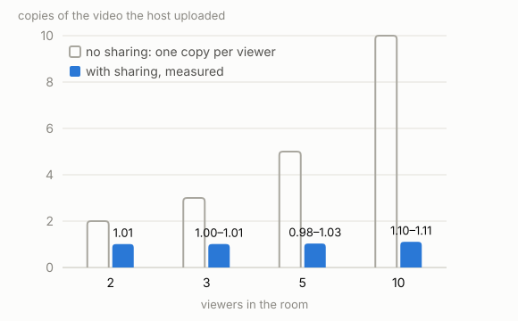
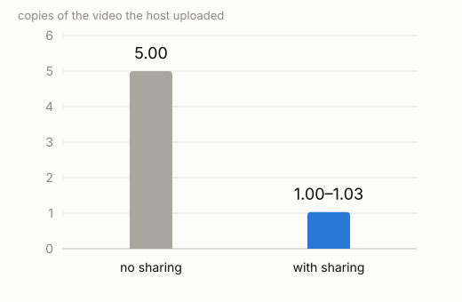

# Synced P2P Watchalong: results

A group watches one video file together, in step, and the file travels browser to browser from
the person who has it. This document says what was built, what was measured, and what the
measurements do not show. Every number below names the setup it was measured in and links to the
folder that holds it.

**Words used throughout.**
- The **host** is the person sharing the file.
- **Host copies** is how many full copies of the video the host uploaded for the room, over the
  measured window. With N viewers and no sharing it is N: one copy per viewer.
- **Peer fraction** is the room's figure: the share of all the video bytes the viewers received
  that came from other viewers rather than from the host.
- The **main setup**: host upload 10 Mbit/s, every viewer's upload 10 Mbit/s, downloads not
  limited, no loss or delay, 2-second video pieces of one 2.64 Mbit/s video, 5 viewers, a
  6-minute run of which the last 3 minutes are measured. All on one test PC.
- **Night 1** (2026-10-26, build `973c6df2`) and **night 2** (2026-10-27, build `cfe649a6`) are
  the two measurement nights. Between them only the test harness changed, not the app
  (`39bdf49e`).

## 1. What it is

One person picks a video file on their own computer and sends an invite link. Everyone who opens
it watches the same moment of the same file, and the viewers pass pieces of the video on to each
other, so the host does not have to upload a full copy to every viewer.

**No server holds, reads or stores the video.** The servers carry descriptions of it: the room's
state, the signalling that lets browsers connect, and the playlist. The host's browser tab is the
source of the video, and it converts the file into streamable pieces in the browser itself. The
one exception: a connection that cannot go direct between two browsers falls back to a relay,
which forwards encrypted bytes it has no key for. It stores nothing and cannot tell that they are
video. Every other connection is direct, browser to browser.

## 2. Prior art, and what is original

This is not a new idea. Synchronized peer-to-peer streaming was published in 2010 (SyncStream,
IEEE). `webtorrent-desktop-multiplayer` and FileParty already do room-based watching over
WebTorrent. Teleparty, Watch2Gether and Discord's Watch Together sync playback but leave delivery
to a streaming service; Syncplay syncs local players but needs every viewer to have the file.
Peer-to-peer delivery itself is WebRTC and `p2p-media-loader`'s work, not this project's.

What none of those states is how closely the room is held, what the host's upload costs, or what
holding a room in step does to the sharing. That is what this project measures. Its contribution
is a working, measured implementation and an explicit treatment of that tension.

**Written for this project:** the clock-offset estimation and its filter; the playback-speed
controller that keeps each screen in step; the measurement, from the frame each screen actually shows, of how far apart the
screens are; the replicated play/pause/seek state; the look-ahead control that paces the host and
keeps the room ahead; the assignment of a first fetcher for each piece at the buffer edge;
late-join and leave recovery; the room and application logic; and the measurement harness.

**Integrated, not written here:** `hls.js` (playback), `p2p-media-loader` (peer transport and
piece exchange), the browser's WebRTC (connections and NAT traversal), `mp4box.js` (the
in-browser conversion), and React.

## 3. The headline

**Sharing keeps the host near one copy.** With 5 viewers the host sent 0.98–1.03 copies, where
no sharing means 5; the highest, 1.033 of 5 copies, is 20.7%. Viewers together got 0.79–0.80 of the
video from other viewers. Main setup, night 1, 3 of 3 tests met the goal (13d "A5: 3/3 runs
pass").

**A bigger room barely costs the host more.** With 2, 3 and 10 viewers the host sent 1.01,
1.00–1.01 and 1.10–1.11 copies; the highest at 10 viewers, 1.107 of 10, is 11.1%. With 10
viewers, they together got 0.89 of the video from other viewers. Main setup, night 1: 2 tests each at 2
and 3 viewers (13d "A2 (reading)"), 3 tests at 10 (13d "A10: multiplier ≤2.0 met in 3/3 runs").

**The same connection, with and without sharing.** With a 20 Mbit/s host and 5 viewers, the host
sent 1.00 and 1.03 copies with sharing (night 1, 2 tests; 13d, product at 20 Mbit: multiplier ≤ 1.5 met in 2/2
runs). Without sharing it sent 5.00 copies (night 2, 1 test; 13e B2-n20 "valid, multiplier 5.00,
every viewer realtime 1.00, no stalls"). Two night-1 tests without sharing read 5.001 and 5.000,
labelled "supplementary, post-result". A 10 Mbit/s host cannot play 5 viewers
without sharing at all: they played at 0.66–1.00 of real time with 11–43 freezes each (13d,
supplementary). Five viewers need 5 × 2.64 = 13.2 Mbit/s, which is 132% of that uplink (arithmetic,
not a measurement). So there is no 10 Mbit/s comparison, and none is quoted.

**The pacing is what leaves the host's connection free.** This project replaced the sharing
library's default fetch-ahead with a look-ahead control paced below the host's uplink. With a
10 Mbit/s host and five viewers, the host's uplink ran about 30% full (0.288–0.303, night 1, 3
tests) where the library's defaults kept it about 99% full (0.995 and 0.993, night 2, 2 tests),
and the host sent 0.98–1.03 copies. With the defaults no copies figure exists, because a full
uplink measures its own capacity, not sharing. The defaults still shared and stayed in step:
peer fraction 0.777 and 0.793, with the median and 99th-percentile sync goals met (13e "ND (2): no
multiplier (utilisation 0.99, download ratio about 3.1–3.4); peer fraction, median and p99 met in
both"). So the gain is a free connection, not more sharing. The two sides ran on different
nights' builds, one factor apart, with only harness conditions changed between them.

**Edge assignment helps the room recover after a drop.** The host's connection fell from 10 to
1 Mbit/s for 1.7–2.0 minutes and then came back. In the window after it came back, the viewers
froze 2, 0 and 0 times (summed over 5 viewers) against 109, 20 and 35 with the near-deadline fetch
rule switched back to the earlier one, on the same build. During the drop itself every viewer, in
both versions, went 93–132 s with no new picture. Night 2, 3 alternating pairs, 8-minute runs with
the last 4 minutes measured (13e "Q (3 pairs, all valid)").

**What is not shown.** That edge assignment cuts host copies: "not shown in these trials" (13d E,
3 valid pairs of 4; 13e E10, no valid pair). That the scheduler gains anything in steady play: "No
gain is established against the control arm, on any criterion" (9b).

**The tension the project is about is real at the buffer edge, and absent when the room is
ahead.** A synced room asks for each piece at the same instant, so no viewer holds it first to
share. In an earlier test round, a room at its buffer edge shared almost nothing after a seek:
peer fraction 0.014 and 0.000 (8a `trap-seek`: 10 Mbit/s host, five viewers, the library's
default windows, 4-second pieces, 2 accepted runs; "T1, the trap reproduced — on the post-result
D9 series, registered before its runs"; the first series read "not reproduced within budget").
In another, a room that stayed ahead shared 0.79: peer fraction 0.792, host copies 1.047, beside a
same-build control at 0.799 (7c `regimes-limited-shaped`: 20 Mbit/s host, viewers 10 Mbit/s,
4-second pieces, medians of 3 runs; "Reading 1 — the engine passes").

## 4. How it works

**Clock.** Each browser estimates its clock offset against the room server with NTP-style
round trips over the websocket. Samples are noisy, because a queued uplink delays one direction
and not the other, so they are filtered (the smallest round trips, and a moving estimate) before
use. The filter takes its samples from a probe function, so it is tested against manufactured
asymmetry, loss and steps with no network.

**Speed controller.** The room's position at any shared instant is computed from the replicated
play state. Each viewer reads which frame is actually on screen (`requestVideoFrameCallback`, not
`currentTime`) and nudges its playback speed by at most 1% to close the gap. A gap too large to
close by speed is closed by one jump to the room's position (the far skip).

**Look-ahead control.** The library's own fetch-ahead races for pieces far in the future and
fills the host's uplink. The control sets the library's fetch-ahead windows and the host's send
rate from the shared clock and each viewer's buffer, aiming below the uplink's capacity, so the
room stays ahead and the connection stays free for the clock and the urgent pieces.

**Assignment at the buffer edge.** When the room is at its edge every viewer wants the same piece
at the same instant. Each piece in the next stretch then gets an assigned first fetcher; the others
take it from that viewer, so the host sends it about once. Further ahead, the library's own spread
is left alone.

**The host's tab is the source.** The host's browser serves every piece; it is the source of last
resort by construction, so viewers take from each other first.

**In-browser conversion.** The host's file is cut into streamable pieces in the browser with
`mp4box.js`: a remux, never a re-encode, and no server touches the file.

## 5. How it was measured

Every figure in sections 3, 6 and 7 comes from the measurement harness on one PC: a container for
the host's origin and one per viewer, each running headless Chrome, with each container's
outgoing traffic shaped (`tc`) to the stated upload rate. Downloads are not shaped. The video is
one 2.64 Mbit/s source cut into 2-second pieces. A run lasts 6 minutes and the last 3 are
measured, unless a section says otherwise. Each condition ran 1 to 4 times, on one build per night.

Sync is measured from the presentation time of the frame each viewer actually displayed, on a
fixed synthetic 16.7 ms frame cadence, so a gap below one frame cannot be told from zero. It is on
**reconstructed lab time**: the pages agree with each other to 0.6 ms, but every page's clock moved
12–14 ms against wall time over 6 minutes, where 2 was allowed (13c's timebase check). Gaps between
viewers are unaffected; the claim that a page's instant is the harness's wall time is lost.

## 6. The four goals

The proposal set four goals. The latest tests, nights 1 and 2, read all
four on one build per night.

### 6.1 Sync

**Screens stay within one frame of each other.** On the main setup, the median gap between
viewers was under one 16.7 ms frame in every test, and the 99th-percentile gap was within one
frame (16.7–16.8 ms), with the host's uplink 29–30% full. With 5% of data lost: 99th percentile
within one frame (0.2–16.8 ms), uplink 31–33% (13d "L: 3/3 runs pass"). With every link 25 ms
delayed: median and 99th percentile within one frame (16.6–16.8 ms), uplink 30–31%, host copies
1.020–1.045 (13d "D (reading against references): in 3/3 runs … all met"). Night 1, 3 tests each,
reconstructed lab time.

**One viewer 60 ms farther away** than the rest widened the 99th-percentile gap to 43 and 33 ms.
Its clock offset, which it cannot see directly, was estimated at −31.2 and −29.9 ms against the
30 ms the extra distance predicts. Night 2, 2 tests (13e "T (2)"), reconstructed lab time.

### 6.2 Host upload and 6.3 sharing

Both are the headline (section 3): 0.98–1.03 host copies with 5 viewers and 1.10–1.11 with 10,
with peer fractions of 0.79–0.80 and 0.89.

### 6.4 Join and leave

The goal: a late joiner is in step in under 2 seconds, and a viewer leaving freezes nobody.

**A late joiner** is in step 4–10 ms after its first picture, in 3 of 3 tests, and 3.1–3.3 s
(3 081–3 254 ms) after it joins the room, in 0 of 3 under 2 s. A fifth viewer joining four, night
1, 3 tests (13d "J join (reading)"), with both definitions: from entering the room, and from the
first frame shown. An earlier test round, at 2-second pieces, read a first frame at 3 076 ms (met)
and the resync met, but the host's share missed: it sent the joiner 11 pieces where 4 were allowed (11a-2, "Criterion 4 at 2 s
(T17)").

**A viewer who passes video on can drop out** without anyone else freezing: its network was cut
in 3 of 3 tests, and no remaining viewer froze (13d "J cut: 3/3 runs exercised … and all pass").
An earlier test round read the first fetcher's leave as met (12c-1: "three of three exercised
`12c1-leave-first-2s` runs, K1 and K3 met", five viewers, 10 Mbit/s host).

## 7. Under stress and over time

**Weaker connections.** Night 2, 2 tests each (13e "U (6 valid)").
- A 5 Mbit/s host: 1.043 and 1.047 copies, peer fraction 0.793 and 0.795, no freezes. Met.
- One viewer's upload at 1 Mbit/s: peer fraction 0.671 and 0.665, met; host copies 1.716 in one
  test, missed against the 1.5 goal, and no copies figure in the other.
- Every viewer's upload at 3 Mbit/s: peer fraction 0.278 and 0.478, missed; no copies figure; the
  99th-percentile sync goal missed; 7 freezes in one test.

**A connection drop**, **the library's defaults** and **one far-away viewer** are in sections 3
and 6.1.

**Catching up.** A viewer 0.5 s behind closed the gap by playing up to 1% faster, into 40 ms in
51.4 and 48.8 s. A viewer 2 s behind closed it with one jump in 3.1 and 3.2 s. Neither caused a
freeze or moved the others. Night 2, one viewer paused, 4 tests (13e "K (4)").

**An hour-long room.** Over 57 measured minutes of a 60-minute run, the viewers together got 0.797
of the video from other viewers; nobody froze, playback ran at 1.0000 of real time, and each viewer's
storage stayed at or under its 1 GiB limit (1 073 741 824 bytes) while 1 209 083 368 bytes were
fetched (13f "W attempt 2 … valid, gate met", 1 test). A 6-minute main-setup run on the same build
read 0.9997 host copies and peer fraction 0.7996 (13f "R0 … valid").

## 8. The hosted instance

One run's observations on the hosted instance, 2026-10-26: 3 members on 2 networks (home
broadband and a phone on mobile data), one of them forced through the relay. Not a measured
result, and no goal applies (13-2's hosted pass, "one run's observations … not a §6 figure, no
bar").
- The host's file prepared and played in the browser; both guests played. The relayed guest
  showed `0 direct · 1 relayed`, the phone `1 direct`.
- The server never served the video: `/media/master.m3u8` answered `404` during the room.
- Each page loaded 3.5 MB on a first visit. The room server's memory peaked at about 100 MB
  (102 016 KiB), and it used 0.5% of one CPU in a 10-second sample while the room played.
- Each member's start wait read 353–418 ms on its Stats panel. That is a different span from the
  lab's waits in section 9 and is not compared with them.

## 9. Limits

What the tests do not show, in plain words.

1. **The wait.** With 5 viewers, a start took 4.1–5.2 s and a seek 4.7–6.0 s, all eight resumed
   once every viewer was ready (night 1, 4 tests; 13d's E product runs). The wait runs from the
   start or seek (a start from the last viewer's join) to the moment the room plays.
   An earlier test round measured the same span at 2-second pieces: start 5.6 and 5.8 s, seek 5.1
   and 6.2 s (11a-2, "The wait at 2 s … Missed"; the 5.1 s seek rests "on a post-result reader
   repair"). Its parts: wait = loading + settling + a 300 ms lead; for example 5 562 = 5 326 − 64 +
   300 ms. Neither reading is an improvement on the other. At least 2.3 s of every start is fixed:
   2 000 ms with the roster unchanged, then the 300 ms lead. A file whose keyframes are far apart
   (up to 10 s) waits about 10 s.
2. **Ten viewers wait longer, and most holds ran out.** Of four held moments with 10 viewers,
   three waited the full 10 s safety limit and then played anyway, which counts as a failed hold:
   both starts and one seek. The one that did not took 9.4 s. Night 2, 2 tests.
3. **One test PC**, headless Chrome, with uploads limited but not downloads. Nothing here was
   measured over the real internet.
4. **Sync is on reconstructed lab time**, not filmed on a screen. A gap under one frame cannot be
   told from zero, and sound was not timed, only video frames.
5. **The relay works, but its sharing and sync are not measured.**
6. **One video at one quality; 2 to 10 viewers, 10 being the rig's limit; 1–4 tests per setup**,
   so the figures are ranges, not averages or confidence intervals. Delay was measured only at 5
   viewers, with one uniform delay and one uneven path.
7. **Not tested:** other loss rates, jitter, mixed delays, weak downloads, rooms over 10 viewers,
   real home connections, and a whole film (one hour was the longest).
8. **Catching up is slow for small gaps.** The 1% speed limit means a 0.5 s gap takes about a
   minute (section 7). The smallest correction the controller acts on is not qualified in the
   harness.
9. **The 1 GiB storage limit has a cost that is not measured.** A viewer drops pieces behind its
   playhead once its store reaches the limit, about 50 minutes of the test video. A seek back past
   that, or a late joiner parked there, then draws those pieces from fewer viewers or from the
   host.
10. **A muted viewer in a background tab stops playing.** Chrome pauses a muted video while its
    tab is hidden. On return the viewer is put back at the room's position and lands 1.0–4.6 s
    off. An unmuted viewer plays on.
11. **The host must keep the room's tab in front.** While the host's tab is hidden it sends
    nothing, and its viewers stall once their buffer runs out.

## 10. Reproduce

The product is in `app/`. `cd app; npm install; npm run check` runs the structural rules and
every assertion suite in seconds, with no browser. `npm run dev:file` serves the app on
`http://127.0.0.1:8100` with a local tracker, where you can host a file of your own.

The harness is `app/harness/` (Docker, one container per browser, `tc` shaping) and its runner
`app/scripts/harness-run.mjs --condition <name>`, with the conditions in
`app/harness/conditions.json`. `app/scripts/measure-night.mjs` reads a night's runs into verdicts,
and `app/scripts/measure-graphs.mjs` draws the figures. The verdict and figure summaries the
numbers above come from are kept under `app/results/`, in the folders below; the individual run
folders are not part of this repository.

**Where each figure is.**

| Figures | Folder |
|---|---|
| Night 1: 5, 10, 2 and 3 viewers; the 20 Mbit/s pair; loss; delay; join and cut; the wait | `app/results/13d-verdicts-2026-10-26-d1-repair/` |
| Night 2: no sharing at 20 Mbit/s; the defaults; the drop; one far viewer; weaker connections; catching up; ten-viewer waits | `app/results/13e-session-2026-10-27/verdicts/` |
| The hour | its figure data in `app/results/13g-figures-2026-10-29T01-38-55Z/` |
| Uplink use for the pacing pair; the figures' data | `app/results/13g-figures-2026-10-29T01-38-55Z/` |
| The timebase check | `app/results/13c-readings-2026-10-26T15-40Z/` |
| The write-up's three charts and their data | `app/results/13-3-figures-2026-11-03T11-46-15Z/` |
